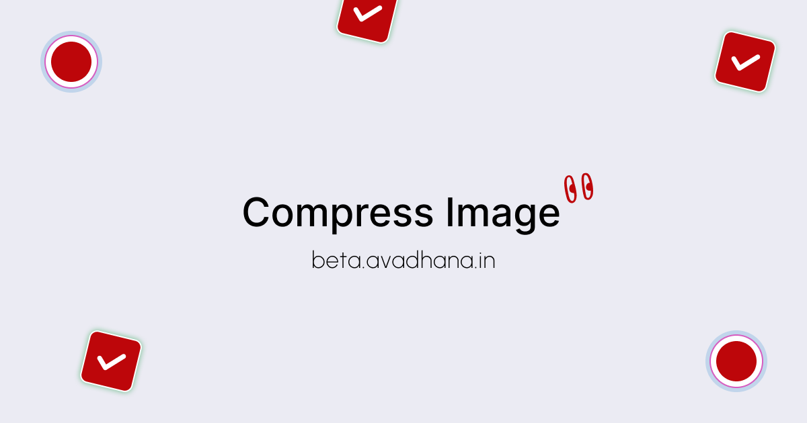

# Privacy First Compress

Compress photos right in your browser. Nothing is uploaded, ever.

**Live app:** https://privacy-first-image-compress.vercel.app



## Why I built this

My phone and laptop kept running out of storage. I didn't want to delete photos, and I didn't want them to look worse either. The online compressors I tried all work the same way: you upload your pictures to someone else's server and hope they get deleted afterwards. For personal photos I wasn't comfortable with that.

So in 2025 I built a compressor where all the work happens on your own device. Your browser does the compression, and the page can't even open a network connection to send your files anywhere.

## Features

- **100% local.** Images are processed in browser memory. No server, no account, no tracking or analytics.
- **Batch compression.** Drop in many images at once and download them as one ZIP.
- **Three levels.** Pick better quality or smaller files, with an optional "bias toward quality" setting.
- **Keeps photo details.** Date taken, camera and location stay in compressed JPEGs, so your gallery still sorts them correctly. You can switch this off.
- **Never makes a file bigger.** If compression doesn't help, you get the original back.
- **Keeps transparency.** Transparent PNGs become WebP, which keeps the transparent areas.

| Input | Output |
|---|---|
| JPEG | JPEG (metadata kept) |
| WebP | WebP |
| PNG with transparency | WebP |
| PNG without transparency, BMP, others | JPEG |
| GIF, SVG | Left unchanged |

## Don't trust me, check it

1. Open the app and press `F12` to open DevTools, then go to the **Network** tab.
2. Compress some images.
3. You'll see no requests at all while it works.

The page also ships a Content Security Policy with `connect-src 'none'`. That tells the browser to block every `fetch`, XHR, WebSocket and beacon from the page, so even a bug couldn't upload your images. Fonts are bundled with the app, so the page doesn't contact Google Fonts or any other third party.

## Run it yourself

```bash
git clone https://github.com/Krunalio/Privacy-first-image-compress.git
cd Privacy-first-image-compress
npm install
npm start        # dev server at http://localhost:3000
npm test         # run tests
npm run build    # production build in ./build
```

The build is a set of static files. You can host it anywhere, or open it on a machine with no internet connection.

## How it works

Each image is drawn onto an HTML `<canvas>` and re-encoded with `canvas.toBlob()` at the quality you picked. For JPEGs, the original EXIF block is copied into the new file, with the orientation tag reset because the browser has already rotated the pixels. The main code is in [`src/utils/compress.js`](src/utils/compress.js) and [`src/utils/exif.js`](src/utils/exif.js).

## Contributing

Issues and pull requests are welcome. Some ideas:

- Resize options (max width/height)
- Offline install as a PWA
- AVIF output
- Moving from Create React App to Vite

## License

[MIT](LICENSE) © Krunal
